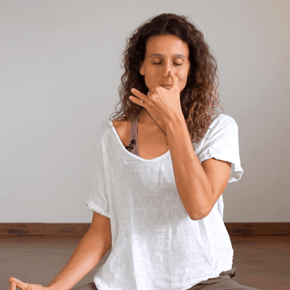

# Temple

[](https://github.com/ra-and5/temple/actions/workflows/tests.yml)

**Un juego serio que te guía cada día para respirar, meditar, estirar y hacer flexiones, y que comprueba con la webcam que lo haces bien.**

Práctica 2 de Interacción Persona-Máquina (Grado en Ingeniería en Inteligencia Artificial, Universidad de Alicante, curso 2026-2027).

*Temple* es la calma para no perder los nervios y también el valor para afrontar un reto. En inglés es un templo, el sitio al que vuelves cada día.

## Por qué lo hicimos

Meditar y cuidar el cuerpo cada día es algo que siempre hemos querido hacer y nunca empezábamos. Queríamos un entrenador que nos guiara paso a paso y que comprobara de verdad que lo hacemos bien, sin tocar el teclado y sin tener que fiarnos de nosotros mismos.

## Qué es

Un ritual diario de cuatro fases que va de la calma al cuerpo. La cámara no se limita a poner un temporizador. Mira lo que haces y solo avanza cuando lo haces bien.

| Fase | Qué haces | Qué comprueba la cámara |
|---|---|---|
| **Respiración** | Respiración alterna, un ejercicio de pranayama | Qué lado de la nariz tapas en cada momento |
| **Meditación** | Sentado, con los ojos cerrados | Que estés quieto, recto y con los ojos cerrados |
| **Estiramientos** | Siete posturas de cuello, hombros y brazos, sentado | Que estés en la postura, y te dice qué te falta |
| **Flexiones** | En el suelo, de lado a la cámara | Las cuenta y mira que bajes y que el cuerpo vaya recto |

Es un **juego serio** porque no está hecho solo para entretener. Sirve para crear un hábito sano. Temple es una ayuda para practicar y no sustituye a un profesional de la salud.

> **Documentación.** Para usarlo, sigue este README. Para ver cómo funciona por dentro (la cámara, cada fase y cada archivo), [docs/como-funciona.md](docs/como-funciona.md). Para saber por qué está hecho así, [docs/decisiones.md](docs/decisiones.md).

## La respiración alterna

El **pranayama** son los ejercicios de respiración del yoga. La **respiración alterna** (en sánscrito *Anuloma Viloma* o *Nadi Shodhana*) es uno de los más conocidos. Se tapa un lado de la nariz con los dedos, se coge aire por el otro y se va cambiando de lado. Se suele hacer antes de meditar para calmar la mente.

<p align="center">
  
  <br>
  <sub>Anabel Otero haciendo la respiración alterna. Fragmento de su vídeo <a href="https://www.youtube.com/watch?v=CacBxE8bXao">Pranayama para principiantes (Anuloma Viloma)</a>, citado con fines educativos.</sub>
</p>

Temple sigue ese vídeo. Con la mano derecha, el pulgar tapa el lado derecho y el anular el izquierdo. Cada vuelta es así.

1. Inhalas 4 tiempos por la izquierda.
2. Tapas la izquierda y exhalas 8 por la derecha.
3. Inhalas 4 por la derecha.
4. Tapas la derecha y exhalas 8 por la izquierda.

En la variante avanzada, después de cada inhalación se aguanta el aire 16 tiempos con los dos lados tapados.

La cámara no ve el aire. El juego marca el ritmo con una cuenta y la cámara comprueba que tapas el lado que toca.

**Para saber más**

- [Pranayama para principiantes (Anuloma Viloma)](https://www.youtube.com/watch?v=CacBxE8bXao), de Anabel Otero. El vídeo completo en español, primero explicado y luego hecho contigo.
- [How and Why To Try Alternate Nostril Breathing](https://health.clevelandclinic.org/alternate-nostril-breathing), de la Cleveland Clinic, en inglés. Qué es, cómo se hace y para qué sirve, contado por una médica.

## Cómo se gana

> Cada fase te da de **0 a 3 lotos** según lo bien que lo hagas. **5 días con 3 lotos te suben de nivel.** Hazlo cada día para mantener la **racha**.

Los lotos salen del porcentaje del tiempo (o de las flexiones) que lo haces bien. Con un 40 % sacas 1, con un 65 % sacas 2 y con un 85 % sacas 3. Es la misma regla en todas las fases.

| Fase | Niveles |
|---|---|
| Respiración | Principiante → Avanzada, con el aire aguantado |
| Meditación | 5 → 8 → 12 → 17 → 23 → 30 → 40 minutos → sin límite |
| Estiramientos | No suben. Son el calentamiento antes de las flexiones |
| Flexiones | Fácil, 5 → Técnico, 5 → Técnico, 10 |

Cada día cuenta una vez y solo jugando tu nivel más alto. Puedes bajar de nivel un día flojo, pero así no subes. Un nivel ganado no se pierde nunca.

## Instalación

Funciona en **Ubuntu** y en **macOS** 13 o más nuevo, con chip de Apple o Intel. Hace falta una webcam e internet para instalar.

1. Descomprime el zip.
2. Abre una terminal dentro de la carpeta `temple`.
3. Ejecuta el instalador.

```bash
bash instalar.sh
```

Desde GitHub es igual, después de clonar el repositorio y entrar en la carpeta.

```bash
git clone https://github.com/ra-and5/temple.git
```

El instalador lo hace todo solo y se puede repetir sin miedo.

1. Busca Conda. Si no está, pregunta y instala Miniconda en `~/miniconda3`.
2. Crea el entorno `temple` con Python 3.12, porque MediaPipe 0.10.21 no funciona con versiones más nuevas.
3. Instala las librerías de `requirements.txt` con las versiones fijadas.
4. Baja los tres modelos de MediaPipe a `models/` y comprueba que son los mismos con los que lo probamos.
5. Pasa todos los tests para confirmar que funciona.

Tarda unos 5 minutos. En nuestro Ubuntu, con Conda ya instalada, 2 minutos y medio.

En macOS, la primera vez pide permiso para usar la cámara desde la Terminal. Si no sale la imagen, actívalo en Ajustes del Sistema → Privacidad y seguridad → Cámara, y vuelve a abrir Temple.

Para quitarlo todo hay otro script. Borra el entorno y los modelos, pregunta antes de borrar tu progreso y solo quita Miniconda si la instaló Temple.

```bash
bash desinstalar.sh
```

## Tu primera vez, paso a paso

Unos 25 minutos con las duraciones de verdad. Arranca el juego.

```bash
bash jugar.sh
```

1. **Colócate.** Sentado, a medio metro de la cámara y con luz de frente. Se te tiene que ver de la cabeza al pecho, con los codos.
2. **Ritual de hoy.** En el menú, señala con el índice el botón «Ritual de hoy» y espera a que se rellene. También vale el ratón o Enter.
3. **Respiración.** La primera vez cada fase empieza con su tutorial, que aquí te enseña a tapar cada lado. Al acabarlo, pulsa Empezar y haz la sesión.
4. **Meditación.** «Seguir» te lleva a meditar. Tutorial y sesión con los ojos cerrados. Si te mueves o te encorvas suenan dos golpes suaves.
5. **Estiramientos.** Tutorial y sesión. Abajo te dice qué te falta en cada postura.
6. **Flexiones.** Pon el portátil en el suelo a unos 2 m y ponte **de perfil**, como la silueta que sale sobre la cámara. Tutorial y sesión.
7. **Al acabar las cuatro** sale «Ritual de hoy completo». En «Tu progreso» ves la racha y lo que te falta para subir en cada fase.

Para pausar en cualquier momento, enseña la palma abierta y quieta a la cámara, o pulsa Espacio. Para seguir, abre la palma y ciérrala en un puño.

Si algo tarda en reconocerse, la tecla **D** enseña los números que mide la cámara.

## Probarlo entero en menos de 10 minutos

Para corregirlo o enseñarlo sin meditar 5 minutos ni hacer todas las vueltas.

```bash
bash jugar.sh --rapido
```

Acorta todo a la vez. 1 vuelta de respiración, 1 minuto de meditación, 4 s por postura y 2 flexiones, y los mensajes entre pasos duran 1,5 s. Se ven las cuatro fases con su tutorial, su sesión y su resultado. Estas sesiones no cuentan para subir de nivel, y el resultado lo dice.

## Ver una subida de nivel

Para ver cómo se sube sin jugar cinco días hay una demo. Crea en `datos/demo` cuatro días seguidos con 3 lotos en cada fase y arranca con ella. Tu progreso de verdad no se toca.

```bash
bash jugar.sh --demo
```

Haz cualquier fase con 3 lotos y subirás de nivel. Cada vez que se usa `--demo` la demo vuelve a empezar.

## Todas las opciones

Se pueden combinar, y lo que se diga aparte manda sobre `--rapido` (por ejemplo `bash jugar.sh --rapido --minutos 3`). Las sesiones con estas opciones no cuentan para subir de nivel.

```bash
bash jugar.sh --rapido        # todo corto a la vez, para probarlo entero
bash jugar.sh --demo          # cuatro días de progreso para ver una subida de nivel
bash jugar.sh --vueltas 2     # vueltas de respiración
bash jugar.sh --avanzada      # respiración avanzada sin desbloquearla
bash jugar.sh --tiempo 0.5    # segundos de cada tiempo de la cuenta (1 por defecto)
bash jugar.sh --minutos 1     # minutos de meditación (0 es sin límite)
bash jugar.sh --segundos 5    # segundos de cada estiramiento
bash jugar.sh --flexiones 2   # flexiones de la sesión
bash jugar.sh --camara 1      # otra cámara, si hay varias
bash jugar.sh --datos otra    # otra carpeta de progreso
```

## Cómo se maneja

De lejos, con la mano. De cerca, con el teclado o el ratón, como cualquier programa.

| Gesto o tecla | Qué hace |
|---|---|
| Señalar un botón con el índice 1,5 s | Lo pulsa. El dedo tiene que apuntar a la pantalla o hacia arriba, con los demás dedos cerrados |
| Palma abierta, de frente y quieta 1 s | Pausa. Al meditar, por encima de los hombros y 1,5 s. En los estiramientos, solo entre postura y postura |
| En la pausa, palma abierta y luego puño | Sigue |
| Cerrar los ojos 2 s en la pausa de la meditación | Sigue meditando |
| Salir de la cámara | Pausa sola |
| Espacio | Empezar, pausar o seguir |
| Flechas o Tab, y Enter | Moverse entre los botones y pulsar |
| Clic | Pulsar un botón |
| R, E, I, X | Abrir respiración, meditación, estiramientos o flexiones desde el menú |
| T y S en la pantalla de una fase | Tutorial o sesión |
| ← → en la pantalla de una fase | Bajar o subir el nivel que juegas |
| M | Sonido |
| F | Pantalla completa |
| D | Ver los números que mide la cámara |
| Esc | Volver atrás. En el menú pregunta si quieres salir |

### Las pantallas

| Pantalla | Qué tiene |
|---|---|
| **Menú** | Ritual de hoy, Practicar una fase, Tu progreso, Ajustes y Salir. Arriba, las cuatro fases con las hechas hoy marcadas |
| **Antes de empezar** | Cómo colocarte, el nivel, lo que te falta para subir y Empezar |
| **Tu progreso** | La racha, los días de esta semana y el nivel de cada fase |
| **Ajustes** | Sonido, pantalla completa y vueltas de respiración |

## Si algo falla

| Qué pasa | Qué hacer |
|---|---|
| «No se puede abrir la cámara» | Cierra las videollamadas. Si tienes varias cámaras, prueba `bash jugar.sh --camara 1` |
| «La cámara no da imagen» en macOS | Ajustes del Sistema → Privacidad y seguridad → Cámara. Activa la Terminal y vuelve a abrir Temple |
| En un Mac coge la cámara del iPhone | `bash jugar.sh --camara 1` |
| «Faltan los modelos de MediaPipe» o «Temple no está instalado» | `bash instalar.sh` |
| «No te veo» | Aléjate un poco y pon luz de frente |
| «No te veo entero» en las flexiones | Aléjate hasta que se te vean los pies, con el portátil en el suelo y de lado |
| «No veo tu mano, aléjate un poco» | Muy cerca solo se ve el dedo y no la mano entera |
| Señalas y no se pulsa | Índice estirado hacia la pantalla o hacia arriba, los demás dedos cerrados, y quieto 1,5 s |
| La instalación falla en los tests | Copia lo que sale en la terminal y abre un *issue* |

## Cómo está hecho

Usamos tres modelos de [MediaPipe](https://ai.google.dev/edge/mediapipe) ya entrenados. **Pose** da 33 puntos del cuerpo, **Hands** 21 puntos de cada mano y **Face** dice si los ojos están cerrados. No entrenamos nada. Encima ponemos reglas con distancias y ángulos entre esos puntos, medidas en anchos de hombros para que dé igual lo lejos que estés.

El código va en tres capas.

| Capa | Dónde | Qué hace |
|---|---|---|
| Ojos | `temple/camara.py` y `temple/vision.py` | Leen la cámara en un hilo aparte y sacan los puntos |
| Cerebro | Una lógica por fase en `temple/`, más los gestos y el progreso | Deciden qué pasa. No saben que existe una pantalla, así que se prueban sin cámara |
| Interfaz | `temple/interfaz/` | Dibuja y suena con Pygame. Una clase por fase |

Todo está explicado en dos guías.

- **[Cómo funciona por dentro](docs/como-funciona.md).** Cómo ve la cámara, qué mide cada fase, una foto de principio a fin, lo que hemos aplicado de la asignatura y qué hace cada archivo.
- **[Decisiones](docs/decisiones.md).** Todas las decisiones, con el problema que las provocó y lo que descartamos.

## Cómo lo hicimos

| Fecha | Qué pasó |
|---|---|
| 05/11 | Propusimos la idea al profesor y le pareció bien. Montamos el entorno y un primer script que dibuja el esqueleto en directo |
| 11/11 | Un experimento con la cámara decidió cómo detectar qué lado de la nariz se tapa |
| 12/11 | Respiración terminada, con menús que se manejan con el dedo. Se la enseñamos al profesor, costaba atinar a los botones y rehicimos el puntero |
| 18/11 | Meditación con tres modelos a la vez. Teclado y ratón para jugar de cerca |
| 19/11 | Interfaz partida en una clase por fase, tests en GitHub, estiramientos e instalador para un equipo limpio, probado en Ubuntu y en Mac |
| 23/11 | Flexiones |
| 25/11 | Una sola regla de niveles y un menú por pantallas. Primeras pruebas de las flexiones en el suelo y sus arreglos |
| 26/11 | Estiramientos estables gracias a los datos guardados, revisión completa y vídeo |

Cada fase siguió el mismo ciclo. La diseñamos, la probamos con la cámara, apuntamos lo que fallaba con los CSV que guarda cada sesión y la arreglamos.

## Tests

`instalar.sh` los pasa al final. Para pasarlos otra vez basta con repetirlo, porque se salta lo que ya está instalado.

```bash
bash instalar.sh
```

No necesitan cámara. Prueban la lógica de las cuatro fases con cuerpos inventados, los gestos, la navegación con el teclado, la instalación y la aplicación entera. `tests/test_interfaz.py` abre Temple sin ventana con una cámara falsa y juega como un usuario. Recorre todas las pantallas, hace el ritual entero, pausa y sigue en las cuatro fases y comprueba que ningún texto se pisa.

`tests/test_documentacion.py` hace con la documentación lo mismo que los demás con el código. Falla si un archivo no sale en la [guía](docs/como-funciona.md), si una función o una clase no tiene su explicación o si un enlace del README o de las guías está roto.

En GitHub se pasan solos en cada push, midiendo con `coverage` qué parte del código prueban. Además, un Ubuntu y un Mac limpios ejecutan `instalar.sh`, arrancan con `jugar.sh` y lo quitan con `desinstalar.sh`, como un usuario nuevo.

## Lo que aprendimos y lo que haríamos distinto

- **Que pase los tests no significa que funcione.** Una primera versión de la meditación pasaba todos los tests y la borramos entera porque no la habíamos probado con la cámara. Rehecha y probada, salieron fallos que ningún test veía.
- **Medir antes de ajustar.** Cada sesión guarda lo que mide la cámara en un CSV. Con él vimos que los fallos de recto venían de los hombros y no de encorvarse, y que el brazo cruzado fallaba porque la muñeca se salía de la imagen.
- **Los gestos chocan con los movimientos normales.** La palma que pausa saltaba al estirar y al bajar la mano después de meditar, y señalar se activaba con la mano apoyada en la cabeza. Funcionó pensar qué distingue el gesto de verdad. Una mano que pide pausa está quieta y de frente, y un dedo que señala apunta a la pantalla. Ahora probaríamos cada gesto desde el principio con lo que el cuerpo hace sin querer.
- **MediaPipe no es fiable con la mano doblada ni con los brazos cruzados.** Confunde qué dedo o qué muñeca es cuál. Funciona mejor medir algo que no dependa de eso.
- **Si no se ve la palma, no hay mano.** El detector de manos busca primero la palma. Muy cerca de la cámara solo salía el dedo y no detectaba nada.
- **Manejar menús con la mano es más difícil de lo que parece.** Fueron cuatro intentos (cursor fino, imán largo, gesto de señalar e imán corto) hasta que nada se pulsó sin querer.
- **Reorganizar sin cambiar nada, y demostrarlo.** Antes de partir la interfaz grabamos 385 capturas de todas las pantallas, y después salieron idénticas píxel a píxel.
- **Las coordenadas de 0 a 1 engañan.** MediaPipe da x e y de 0 a 1, pero la imagen es más ancha que alta. Comparando un ancho con un alto así, una palma de frente parecía de lado.
- **Lo que la cámara no ve no se puede exigir.** En el brazo cruzado pedíamos sujetar el codo, pero la propia mano lo tapa. Los datos de sujetar y de no sujetar se solapaban, así que dejamos de comprobarlo. Ahora miraríamos los datos antes de pedir algo.
- **Suavizar antes de decidir.** Las líneas del cuerpo temblaban aunque estuvieras quieto. Con una media entre fotos y un segundo de margen, las mismas sesiones pasaron de un 26 % del tiempo fuera de la postura a un 0 %.
- **Decir qué hacer, no qué fallaste.** «Lo que más te ha costado, abrir los ojos» se entendía al revés. Ahora dice «Para mejorar, mantén los ojos cerrados».

## Tecnología y créditos

- [MediaPipe](https://ai.google.dev/edge/mediapipe) de Google, con Pose Landmarker, Hand Landmarker y Face Landmarker.
- OpenCV para la cámara y Pygame para la interfaz, con Python 3.12 y Conda.
- Fuentes Cormorant Garamond y Nunito, con licencia SIL Open Font License, en `assets/fuentes/`.
- La respiración sigue el vídeo de [Anabel Otero](https://www.youtube.com/watch?v=CacBxE8bXao). El GIF es un fragmento de ese vídeo, citado con fines educativos.

## Autores

- Rares Andrei Mocanu
- Nikolas Moses Kaplan
