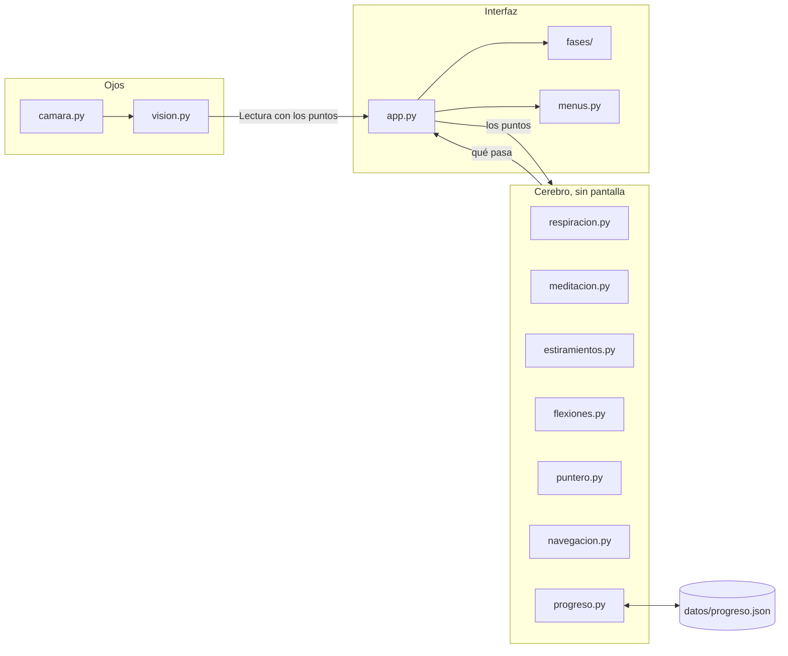
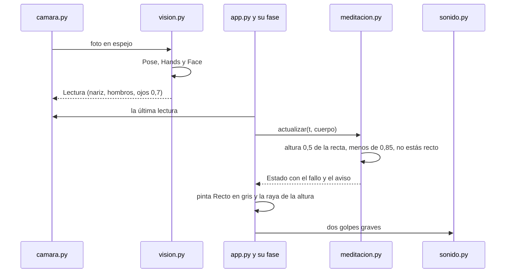

# Cómo funciona Temple por dentro

Esta guía explica el proyecto entero, desde lo que ve la cámara hasta cada archivo del repositorio. Para instalarlo y jugar, mejor empezar por el [README](../README.md). Las decisiones, con el problema que provocó cada una, están en [decisiones.md](decisiones.md).

## 1. Cómo ve la cámara

### Una imagen son números

Para el ordenador una foto es una tabla de píxeles. Cada píxel son tres números de 0 a 255 (rojo, verde y azul). Con eso solo, el ordenador no sabe dónde está tu nariz. Hace falta una red neuronal ya entrenada que encuentre el cuerpo en la imagen. Es lo que da **MediaPipe**, de Google.

### MediaPipe devuelve puntos

Le pasamos una foto y nos devuelve las coordenadas de unos puntos del cuerpo (en inglés *landmarks*). Temple usa tres modelos.

| Modelo | Qué devuelve | Qué usamos | Para qué |
|---|---|---|---|
| Pose Landmarker | 33 puntos del cuerpo | Nariz, orejas, hombros, codos, muñecas, caderas y tobillos | Postura, quietud, estiramientos y flexiones |
| Hand Landmarker | 21 puntos por mano, en 2D y en 3D | Muñeca, puntas y nudillos de los dedos | Tapar la nariz, señalar y la palma que pausa |
| Face Landmarker | Puntos de la cara y 52 *blendshapes*, números de 0 a 1 que dicen cuánto haces cada gesto | `eyeBlinkLeft` y `eyeBlinkRight` | Saber si tienes los ojos cerrados al meditar |

No entrenamos ningún modelo. Usamos los de MediaPipe tal cual y encima ponemos **reglas**, distancias y ángulos entre puntos. Se lo preguntamos al profesor y le pareció bien.

### Las coordenadas van de 0 a 1

MediaPipe no da píxeles. Da la posición como parte de la imagen. `x = 0` es el borde izquierdo y `x = 1` el derecho. `y = 0` es arriba y `y = 1` abajo, al revés que en matemáticas.

Ejemplo. La nariz en `(0,50, 0,40)` está en el centro, al 40 % desde arriba. Unos hombros en `(0,375, 0,60)` y `(0,625, 0,60)` están más abajo y separados 0,25.

### Medir en anchos de hombros

Si te acercas a la cámara todo se ve más grande y las distancias crecen. Para que dé igual lo lejos que estés, dividimos cada distancia entre el ancho de tus hombros.

Ejemplo. El pulgar está a 0,05 de la nariz y los hombros miden 0,25. Son 0,2 anchos de hombros, menos de 0,25, así que tapa la nariz. Si te alejas al doble, el pulgar queda a 0,025 y los hombros a 0,125. Sigue saliendo 0,2.

En las flexiones no sirve, porque de lado los hombros quedan uno encima del otro y su ancho sale casi 0. Ahí la regla es el largo del tronco, del hombro a la cadera.

### Tres detalles que hay que saber

| Detalle | Qué pasa | Qué hacemos |
|---|---|---|
| Espejo | La cámara te ve como te vería otra persona. Si levantas la mano derecha, en pantalla sube la izquierda | Volteamos la imagen antes de todo (`cv2.flip`). Por eso el "hombro izquierdo" de MediaPipe es tu derecho, y el lado lo sacamos de dónde sale en la pantalla |
| Orden de los colores | OpenCV guarda los colores como azul, verde y rojo, y MediaPipe los espera como rojo, verde y azul | Los convertimos antes de detectar (`cv2.cvtColor`) |
| Marca de tiempo | En modo vídeo MediaPipe pide un tiempo que crezca siempre | Usamos la hora en milisegundos y, si se repite, sumamos 1 |

## 2. Cómo está organizado

### Ojos, cerebro e interfaz

| Capa | Qué hace | Qué no sabe |
|---|---|---|
| Ojos | Cogen la foto y sacan los puntos | Si lo estás haciendo bien |
| Cerebro | Recibe números y decide. Si estás recto, qué botón señalas, cuántos lotos, qué nivel tienes | Que existe una pantalla o una cámara |
| Interfaz | Dibuja la pantalla y hace sonar lo que toca | Cómo se calcula nada |

La regla más importante es que **el cerebro no importa Pygame ni OpenCV**. Así se prueba con cuerpos inventados, sin cámara ni ventana, que es lo que hacen casi todos los tests.

### Por qué la cámara va en un hilo aparte

Los modelos tardan de 30 a 50 ms por foto. La pantalla se dibuja 60 veces por segundo, una cada 16 ms. Si todo fuera en el mismo bucle, la pantalla esperaría a la cámara y las animaciones irían a saltos.

Es como un camarero y un cocinero. El cocinero (el hilo de la cámara) deja el último plato en la barra. El camarero (la pantalla) coge lo que haya cuando le hace falta, sin esperar. Un candado (`threading.Lock`) evita que coja un plato a medio servir.

### Una clase por fase

Cada fase es una clase con las mismas funciones, definidas en `temple/interfaz/fases/base.py`. Cómo colocarse, qué cambia en cada nivel, empezar, actualizar con cada foto, lo que dibuja sobre la cámara, su panel y su resultado.

La aplicación no sabe nada de respirar ni de estirar. Solo le pide a la fase activa lo suyo. Es como un enchufe y varios aparatos con la misma clavija. Los estiramientos y las flexiones entraron así, escribiendo su clase y añadiendo una línea en la lista `FASES`, sin tocar las otras fases.

### Una foto de principio a fin

Estás meditando y te encorvas.

| Paso | Archivo | Qué pasa, con números |
|:-:|---|---|
| 1 | `temple/camara.py` | Coge la foto y la voltea en espejo |
| 2 | `temple/vision.py` | La nariz sale 0,10 por encima del centro de los hombros, que miden 0,25. Los ojos dan 0,7, cerrados |
| 3 | `temple/interfaz/app.py` | Recoge la última lectura y se la pasa a la fase activa |
| 4 | `temple/meditacion.py` | Al calibrar, tu nariz estaba a 0,8 anchos de hombros. Ahora está a 0,4, la mitad de tu altura recta. Como baja de 0,85, no estás recto |
| 5 | `temple/meditacion.py` | Si dura más de 1 s es un fallo y resta del porcentaje. Si dura 3 s pide un aviso, que se repite cada 10 s |
| 6 | `temple/interfaz/fases/meditacion.py` | Pone Recto en gris, dibuja la raya hasta donde no debe bajar la nariz y suenan los dos golpes |
| 7 | Al acabar | Sale el porcentaje y los lotos, y `temple/progreso.py` lo guarda y mira si el día cuenta para subir |

## 3. Qué mide cada fase

### Respiración

El juego marca el ritmo con una cuenta de un segundo por tiempo. La cámara mira qué lado de la nariz tapas.

- **Lado derecho tapado.** La punta del pulgar a menos de 0,25 anchos de hombros de la nariz.
- **Lado izquierdo tapado.** La punta de cualquier otro dedo a esa distancia. Con la mano doblada MediaPipe confunde qué dedo es cuál, así que no miramos cuál es.
- **Los dos tapados** (en la avanzada). Los dos a menos de 0,15.
- El veredicto se vota entre las 8 últimas fotos y aguanta 0,6 s si se pierde la mano, porque la mano tapa la cara y el modelo falla a ratos.

### Meditación

- **Quieto.** Lo que se mueve la nariz en 1,5 s, suavizada, tiene que ser menos de 0,10 anchos de hombros.
- **Recto.** Al empezar se mide tu postura recta durante 3 s, con la mediana. Luego la cabeza no puede bajar del 85 % de esa altura. Sentado cerca no se ven las caderas, así que la espalda se mide por la cabeza.
- **Ojos cerrados.** Los dos *blendshapes* de parpadeo por encima de 0,4. En nuestras pruebas, abiertos daban de 0,15 a 0,25 y cerrados de 0,6 a 0,77.
- Si en 12 s no ve los ojos cerrados (gafas, poca luz), sigue igual en vez de quedarse atascado.

### Estiramientos

| Postura | Regla |
|---|---|
| Cabeza a cada lado | La línea de las orejas inclinada 20° respecto a la de los hombros, con la mano de ese lado sobre la cabeza |
| Brazos arriba | Los dos codos por encima de la nariz |
| Brazo cruzado | La muñeca pasa 0,35 anchos de hombros al otro lado del centro del pecho |
| Tríceps | El codo por encima de la nariz y el brazo doblado. El lado es el del brazo más doblado |

Los puntos se suavizan con una media que pesa más lo último, y salirse menos de 1 s no corta la cuenta.

### Flexiones

| Qué mira | Cómo | Fácil | Técnico |
|---|---|---|---|
| Una flexión | El ángulo del codo baja de un límite y luego sube de otro | Baja de 110° y sube de 145° | Baja de 90° y sube de 160° |
| Bajar al suelo | Lo que le queda al hombro hasta la muñeca, en largos de tronco | 0,75 | 0,5 |
| Cuerpo recto | Cuánto se sale la cadera de la línea entre hombro y tobillo | 0,25 | 0,12 |

Se mide el brazo que MediaPipe ve mejor, porque de lado uno tapa al otro. El ángulo se calcula con la mediana de las 5 últimas fotos, y una flexión de menos de 0,4 s no cuenta.

### Los gestos para manejarlo

| Gesto | Regla |
|---|---|
| Señalar | Índice estirado, al menos dos dedos más cerrados y el índice hacia la pantalla o hacia arriba, más de unos 30°. Si el dedo se ve muy corto también vale, porque apunta a la cámara |
| Pulsar | Señalar el mismo botón 1,5 s. Un imán engancha el botón si el dedo está encima o a menos de 28 px |
| Pausar | Palma abierta, de frente (ancha al menos el 60 % de su largo), quieta y lejos de la nariz, durante 1 s |
| Seguir | En la pausa, abrir la palma y cerrar el puño |

Para comparar anchos con altos, la mano se mide en la proporción real de la imagen. MediaPipe da x e y de 0 a 1, y la imagen es más ancha que alta.

### Los niveles

Cada sesión da de 0 a 3 lotos según el porcentaje bien hecho (40, 65 y 85 %). Cinco días con 3 lotos en tu nivel más alto te suben al siguiente. Lo guarda `temple/progreso.py` en `datos/progreso.json`.

## 4. Lo que hemos aplicado de la asignatura

### Visión por computador

| Lo visto en clase | En Temple |
|---|---|
| Cámara RGB, barata pero sin profundidad | Usamos la del portátil. La falta de profundidad la suplimos midiendo en anchos de hombros o en largos de tronco |
| MediaPipe y OpenPose dan el esqueleto en 2D, pero no saben a qué distancia está la cámara | Por eso todo se mide en proporción al propio cuerpo |
| Situación de la cámara y oclusiones | Sentado de frente para respirar, meditar y estirar. De lado para las flexiones. La mano tapa la cara al respirar y el brazo cruzado tapa la otra mano, así que votamos entre fotos y medimos cosas que no dependan de qué dedo o qué muñeca es cuál |
| El detector de manos busca primero la palma y luego los 21 puntos | Muy cerca de la cámara solo se veía el dedo y no detectaba la mano. El juego avisa "No veo tu mano, aléjate un poco" |
| Gestos a partir de la forma de los dedos | Señalar y la palma abierta se reconocen por qué dedos están estirados, con los puntos 3D de la mano |
| Movimiento, acción y actividad | Señalar es un movimiento. Tapar el lado que toca o aguantar una postura es una acción. El ritual de cada día es una actividad, y la racha mira el hábito |
| Usar la secuencia en el tiempo, no una foto suelta | Ventanas de 1,5 s, fallos que tienen que durar 1 s, medianas y suavizados |

### Usabilidad (heurísticas de Nielsen)

| Heurística | En Temple |
|---|---|
| Visibilidad del estado | El botón se rellena mientras señalas. Quieto, Recto y Ojos se marcan en directo |
| Relación con el mundo real | Imagen en espejo, cuenco y campana, y lotos en vez de puntos |
| Control y libertad | Pausa con la mano en cualquier momento, Salir con pregunta y Esc para volver |
| Consistencia | Las cuatro fases se manejan igual y suben de nivel con la misma regla |
| Prevención de errores | Hay que señalar y soltar, así nada se pulsa solo. La palma tiene que estar quieta y de frente |
| Reconocer antes que recordar | Cada botón enseña su tecla y el tutorial enseña los gestos jugando |
| Flexibilidad | La mano de lejos, el teclado y el ratón de cerca |
| Diseño minimalista | Un menú por pantallas, una cosa en cada una |
| Ayudar a corregir errores | Los avisos dicen qué hacer ("Aléjate un poco", "Para mejorar, mantén los ojos cerrados") |
| Ayuda | Un tutorial la primera vez de cada fase y este repositorio |

El diseño ha sido iterativo y con personas de verdad. Cada fase siguió el mismo ciclo. La diseñamos, la probamos con la cámara, apuntamos los fallos y la arreglamos. El CSV de cada sesión nos dio los números para ajustar los límites.

## 5. Archivo por archivo

### Arranque e instalación

| Archivo | Qué hace |
|---|---|
| `main.py` | Lee las opciones de la terminal (`--rapido`, `--minutos`…) y abre la aplicación |
| `instalar.sh` | Instala todo en un equipo limpio. Conda si falta, el entorno `temple` con Python 3.12, las librerías fijadas, los tres modelos con su huella sha256 y los tests al final |
| `jugar.sh` | Arranca el juego con ese entorno sin tener que activarlo |
| `desinstalar.sh` | Quita el entorno y los modelos. Pregunta antes de borrar tu progreso y solo quita Miniconda si la instaló Temple |
| `requirements.txt` | Las librerías con la versión exacta |
| `.github/workflows/tests.yml` | En cada push pasa los tests en un Ubuntu limpio y prueba la instalación desde cero en Ubuntu y en Mac |

### Ojos

| Archivo | Qué hace |
|---|---|
| `temple/camara.py` | Hilo que lee la webcam, la pone en espejo, pasa los modelos y guarda la última lectura. Si no hay cámara o faltan los modelos, deja el aviso |
| `temple/vision.py` | Carga Pose, Hands y Face y devuelve una `Lectura` con todos los puntos. También decide qué lado de la nariz se tapa |

### Cerebro

| Archivo | Qué hace |
|---|---|
| `temple/__init__.py` | Marca `temple/` como paquete de Python, para poder importar sus módulos |
| `temple/respiracion.py` | El guion de la respiración (inhala 4, exhala 8, por cada lado) y cuánto tiempo tapas el lado correcto |
| `temple/meditacion.py` | Calibra la postura y mide quieto, recto y ojos. Decide cuándo avisar y guarda el CSV |
| `temple/estiramientos.py` | Las siete posturas, qué falta en cada una, el suavizado de los puntos y el CSV |
| `temple/flexiones.py` | El ángulo del codo, lo que bajas, la cadera, el contador y el CSV |
| `temple/puntero.py` | Señalar, el imán de los botones, la palma que pausa y el puño que sigue |
| `temple/navegacion.py` | Moverse entre los botones con las flechas y el tabulador |
| `temple/progreso.py` | Sesiones, racha, la regla de los niveles y los ajustes, en `datos/progreso.json` |

### Interfaz

| Archivo | Qué hace |
|---|---|
| `temple/interfaz/__init__.py` | Marca `temple/interfaz/` como paquete |
| `temple/interfaz/app.py` | El bucle del juego, las teclas, la pausa, el ritual y el cambio de pantalla |
| `temple/interfaz/menus.py` | Las pantallas de menú, practicar una fase, antes de empezar, tu progreso, ajustes y salir |
| `temple/interfaz/fases/base.py` | Lo que tiene que saber hacer cada fase y lo que comparten, como guardar la sesión |
| `temple/interfaz/fases/__init__.py` | La lista `FASES`, en el orden del ritual |
| `temple/interfaz/fases/respiracion.py` | Pantallas de la respiración, con el hilo de aire que sube y baja |
| `temple/interfaz/fases/meditacion.py` | Pantallas de la meditación, el reloj, los avisos y seguir con los ojos cerrados |
| `temple/interfaz/fases/estiramientos.py` | Pantallas de los estiramientos y las líneas que marcan hasta dónde llegar |
| `temple/interfaz/fases/flexiones.py` | Pantallas de las flexiones y la silueta de perfil para colocarse |
| `temple/interfaz/marco.py` | Lo que rodea al panel. La barra de arriba, la cámara, la ayuda de abajo y los avisos |
| `temple/interfaz/botones.py` | Los botones y las tres formas de pulsarlos, con el dedo, el ratón y el teclado |
| `temple/interfaz/piezas.py` | Piezas del panel que se repiten en varias fases, como el resultado con los lotos |
| `temple/interfaz/textos.py` | Frases y formatos que usan varias pantallas |
| `temple/interfaz/opciones.py` | Las opciones de la terminal y la carpeta de datos |
| `temple/interfaz/dibujo.py` | Dibujos básicos. El loto, el círculo enso, el fondo, el texto partido en líneas y las partículas |
| `temple/interfaz/estilo.py` | Colores, tamaños y letras |
| `temple/interfaz/sonido.py` | El cuenco, la campana y los avisos, generados con numpy |
| `temple/interfaz/ventana.py` | La ventana. Dibuja a 1280×720 y lo escala a cualquier pantalla, también Retina y pantalla completa |

### Herramientas

| Archivo | Qué hace |
|---|---|
| `herramientas/explorar_pose.py` | El primer experimento. Dibuja en directo el esqueleto de MediaPipe Pose |
| `herramientas/explorar_manos.py` | El experimento que decidió la respiración. Enseña qué lado de la nariz tapa la mano y a qué distancia |
| `herramientas/crear_demo.py` | Inventa unas semanas de progreso en `datos/demo` para enseñar el juego. Con `--dia5`, cuatro días con 3 lotos para ver hoy una subida de nivel |

### Tests

| Archivo | Qué prueba |
|---|---|
| `tests/test_respiracion.py` | Que el guion sigue el vídeo, la retención de la avanzada, los umbrales de tapar y la precisión |
| `tests/test_meditacion.py` | La calibración, quieto, recto, ojos, la tolerancia de 1 s y los avisos |
| `tests/test_estiramientos.py` | Cada postura, lo que falta, el suavizado y que la cuenta solo avance en la postura |
| `tests/test_flexiones.py` | Contar flexiones con una persona de perfil inventada, con la cadera recta o hundida |
| `tests/test_puntero.py` | Señalar, el imán, la palma que pausa, la mano que solo pasa por delante y la apoyada en la cabeza |
| `tests/test_navegacion.py` | Moverse entre botones con el teclado |
| `tests/test_progreso.py` | La racha, la semana, la regla de los niveles y que las sesiones de prueba o de un nivel más bajo no sirven para subir |
| `tests/test_interfaz.py` | Abre la aplicación sin ventana con una cámara falsa y juega como un usuario. Todas las pantallas, el ritual entero, la pausa en las cuatro fases y que ningún texto se pise |
| `tests/test_arranque.py` | Que las opciones de `main.py` llegan a la aplicación y que la demo sale bien |
| `tests/test_instalacion.py` | Los scripts, las versiones fijadas y que los modelos cargan |
| `tests/test_documentacion.py` | Que cada archivo de código sale en esta guía, que cada función tiene su explicación y que los enlaces no están rotos |

### Lo que no se sube a GitHub

| Carpeta | Qué hay |
|---|---|
| `models/` | Los tres modelos de MediaPipe. Los baja `instalar.sh` |
| `datos/` | Tu progreso y los CSV de la última sesión de cada fase |
| `assets/fuentes/` | Sí se sube. Cormorant Garamond y Nunito, con licencia SIL Open Font License |
| `docs/` | Sí se sube. Esta guía, las decisiones y el GIF de la respiración |
